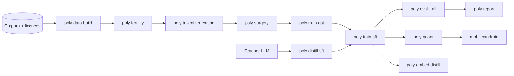

# PolyglotLM

> Adapt an open LLM to low-resource languages (e.g. Hindi, Tamil, Urdu, Bengali) by extending the tokenizer, continued pre-training, distilling from a stronger teacher and shipping a quantised model for phones.

**Concepts:** `Tokenization`, `Fine Tuning`, `LoRA`, `Knowledge Distillation`, `Overfitting`, `Quantization`, `Embeddings`, `LLMs`

PolyglotLM is a reproducible recipe and toolkit. (1) Train new subword tokens for target scripts and merge them into the base tokenizer. Initialise new embeddings smartly (mean of sub-token embeddings or cross-lingual alignment). (2) Continued pre-training with LoRA plus trainable embeddings on cleaned web and book text. (3) Instruction tuning using data translated and generated by a strong teacher (distillation). (4) Overfitting control with per-language held-out sets and mixing ratios. (5) Quantise for on-device use. The project also produces multilingual sentence embeddings for search in these languages.

## Pipeline



| Stage | FR | What it does |
|---|---|---|
| `poly data build` | FR-04 | Licence audit, NFC + script normalisation, PII redaction, quality/toxicity filters, language ID, exact + MinHash dedupe, deterministic held-out split, snapshot manifest with content hashes. |
| `poly fertility`, `poly tokenizer extend` | FR-01 | Token tax (tokens per word) on held-out text; SentencePiece candidates ranked by `freq × (base_tokens − 1)` and appended without moving any base ID. |
| `poly surgery` | FR-02 | Resizes embeddings and LM head, initialises new rows with FVT (mean of sub-token rows) or a bilingual dictionary. |
| `poly train cpt` | FR-03 | LoRA on all linear layers + trainable embeddings/LM head, embedding warm-up, n^0.3 language mixing + English replay, packed sequences. |
| `poly distill sft`, `poly distill review` | FR-05 | Teacher translations + native generations, script and back-translation chrF QA, native-speaker review queue. |
| `poly train sft` | FR-05 | Response-only loss, language-mixed batches, early stopping on held-out native text. |
| every trainer | FR-06 | Per-language held-out perplexity at every eval, overfitting and English-regression alerts, loss-spike monitor, best checkpoint restored. |
| `poly eval --all`, `poly report` | FR-06 | Bits/char (comparable across tokenizers), benchmark tasks and samples for every language; HTML report card + model card. |
| `poly quant`, `poly bench` | FR-07 | GGUF + Q4_K_M via llama.cpp with tokenizer preflight; speed reported as words/s per language. |
| `poly embed distill`, `poly embed search` | FR-08 | Distils an English sentence-embedding space into the adapted model for cross-lingual search. |

## Quickstart: CPU smoke run

```bash
uv sync
uv run poly demo run
```

This builds synthetic corpora, a two-layer base model, and runs every stage above in a few minutes. The report card lands in `artifacts/tiny-demo/report/index.html`. The demo proves the plumbing, not the method: its corpora are template sentences written for testing and never reviewed by native speakers.

On Windows inside OneDrive, keep the virtualenv out of the synced folder and avoid hard links:

```bash
UV_PROJECT_ENVIRONMENT=~/.venvs/polyglotlm UV_LINK_MODE=copy uv sync
```

## Full recipe: Llama-3.2-3B for hi / ta / ur / bn

1. Put corpora under `$DATA_BUCKET` and fill in `recipes/sources/indic.yaml`, including each source's real licence. The pipeline refuses to run while any licence is `UNSET` or outside the allowlist.
2. Set `HF_TOKEN` (gated base model). For distillation, `uv sync --extra teacher` and set `TEACHER_API_KEY`, then point `distill.seed_path` at an openly licensed English instruction set.
3. Run the stages:

```bash
make data LANGS=hi,ta,ur,bn
make tokenizer
make cpt RECIPE=recipes/indic-3b.yaml
make distill sft
make eval
LLAMA_CPP_DIR=~/src/llama.cpp make quant
```

`make` targets call the `poly` commands with `RECIPE` (default `recipes/indic-3b.yaml`). Everything a run produces lives under the recipe's `workdir`, and the recipe, seeds and snapshot hashes are what make it reproducible.

Before training on teacher outputs, check the teacher provider's terms of service; some providers, Anthropic included, restrict using outputs to develop competing models.

## Configuration

| Variable | Purpose |
|---|---|
| `HF_TOKEN` | Gated models and datasets on the Hugging Face Hub |
| `WANDB_API_KEY` | Optional experiment tracking (`--extra tracking`); metrics always go to JSONL too |
| `TEACHER_API_KEY` | Teacher model for distillation (`--extra teacher`) |
| `DATA_BUCKET` | Root that `${DATA_BUCKET}` expands to in source manifests |
| `LLAMA_CPP_DIR` | Built llama.cpp checkout for `poly quant` / `poly bench` |
| `POLY_RECIPE` | Default `--recipe` for every command |
| `POLYGLOT_LOG_JSON=1` | Structured JSON log lines |

## Repository layout

```text
polyglotlm/
├── data/        # download.py, clean.py, langid.py, dedupe.py, pipeline.py
├── tokenizer/   # train_new.py, merge_vocab.py, fertility.py
├── surgery/     # resize.py, init_embeddings.py
├── train/       # mixing.py, blocks.py, guard.py, loop.py, cpt.py, sft.py
├── distill/     # teacher.py, teacher_generate.py, back_translate.py, chrf.py, review.py
├── eval/        # tasks/, harness.py, english_regression.py, charts.py, report.py
├── quant/       # gguf.py, bench.py, to_gguf.sh
├── embed/       # encoder.py, distill.py, search.py
└── demo/        # synthetic corpora, tiny base model, end-to-end runner
mobile/android/  # offline llama.cpp chat app (Kotlin + JNI)
recipes/         # indic-3b.yaml, tiny-demo.yaml, sources/
tests/           # pytest suite, CPU only
```

## What is and is not verified

Verified on CPU by the test suite (`uv run pytest`):
- every stage end to end on tiny models;
- append-only vocabulary and lossless NFC/NFD round trips on all five scripts;
- unchanged English logits after surgery;
- improving held-out perplexity in CPT;
- QA rejections in distillation;
- deterministic evaluation;
- llama.cpp command construction.

Not verified here:
- a real Llama-3.2-3B run and the PRD's quality targets;
- the GPU path (bf16 autocast) and multi-GPU training, which is not wired yet;
- real llama.cpp conversion of an extended-vocab model;
- the Android app, which has not been compiled (see `mobile/android/README.md`).

Run the eval suite on real data before claiming any quality or speed result.

## Docs

| File | Contents |
|---|---|
| [BRAIN.md](BRAIN.md) | Concept primers, research, experiments, decision log |
| [CLAUDE.md](CLAUDE.md) | Instructions for AI coding assistants |
| [DESIGN.md](DESIGN.md) | UX flows, screens, wireframes, visual language |
| [PRD.md](PRD.md) | Problem, users, requirements, metrics, roadmap |
| [SYSTEM_ARCHITECTURE.md](SYSTEM_ARCHITECTURE.md) | Components, data flow, deployment, failure modes |
| [TECHNICAL.md](TECHNICAL.md) | Stack, data models, APIs, algorithms, setup |

## Contributors

- [@mohi2006august](https://github.com/mohi2006august)
- Claude (Anthropic), AI pair programmer; co-author on the commits

No licence has been chosen for this repository yet.
