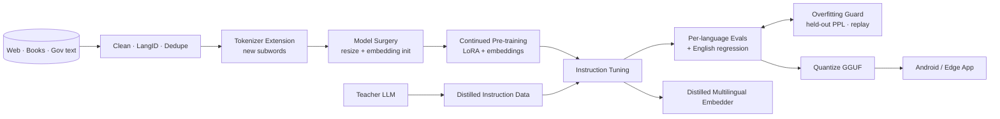

# PolyglotLM: System Architecture

> Adapt an open LLM to low-resource languages (e.g. Hindi, Tamil, Urdu, Bengali) by extending the tokenizer, continued pre-training, distilling from a stronger teacher and shipping a quantised model for phones.
>
> **Concepts:** `Tokenization`, `Fine Tuning`, `LoRA`, `Knowledge Distillation`, `Overfitting`, `Quantization`, `Embeddings`, `LLMs`

## 1. High-Level View

A staged training pipeline: data → tokenizer → model surgery (vocab resize + init) → continued pre-training → SFT (distilled data) → evaluation → quantisation → deployment artifacts. Each stage is versioned and evaluated per language.

## 2. Components

| Component | Responsibility |
|---|---|
| Data pipeline | fastText LangID, Unicode NFC normalisation, MinHash dedupe, quality classifier. |
| Tokenizer extender | Trains SentencePiece on target text; filters tokens already representable; merges vocabularies. |
| Model surgery | Resizes embeddings/LM head; initialises new rows. |
| CPT trainer | LoRA r=64 on all linear layers + trainable embeddings; packed sequences. |
| SFT data factory | Teacher-generated/translated instructions with back-translation QA. |
| Evaluator | IndicGLUE/FLORES/IndicQA-style tasks, perplexity, English MMLU/HellaSwag subsets. |
| Quantiser + mobile | llama.cpp conversion; Android JNI demo. |

## 3. Request / Data Flow

1. Measure baseline fertility per language.
2. Clean corpora (target: 5–20B tokens across languages).
3. Extend tokenizer; re-measure fertility.
4. Initialise embeddings; warm up embeddings only (1k steps).
5. Continued pre-training with language curriculum + English replay.
6. SFT with distilled instructions; early stop on held-out.
7. Evaluate; quantise; ship.

## 4. Data Stores

| Store | Holds | Why |
|---|---|---|
| S3/GCS | Corpora snapshots, checkpoints | Large data. |
| W&B | Runs, per-language curves | Tracking. |
| HF Hub (private→public) | Tokenizer, adapters, merged + GGUF models | Distribution. |

## 5. Deployment Topology

- Training on 8×A100/H100 node (or multi-node).
- Serving: vLLM for server; llama.cpp for mobile/edge.

## 6. Scaling Strategy

- Data loading with streaming datasets; FSDP for full-embedding training.

## 7. Security & Privacy

- Data licence audit; PII removal.
- Safety tuning and red-teaming in target languages.

## 8. Observability

- Per-language loss/perplexity curves, fertility dashboards, eval heatmaps.

## 9. Failure Modes

| Failure | Detection | Response |
|---|---|---|
| Loss spikes after vocab resize | Loss monitor | Lower LR, longer embedding warm-up, re-check init. |
